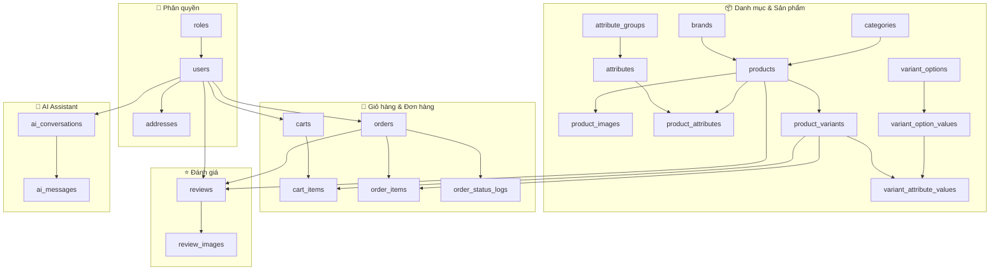
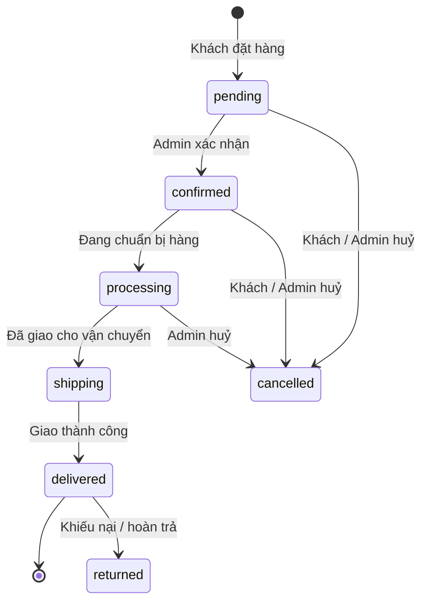
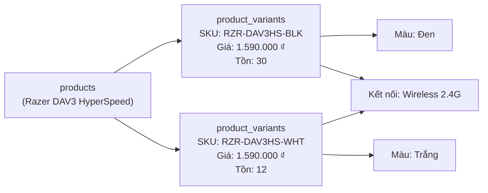

# 🗄️ ZenTech — Thiết kế Cơ sở Dữ liệu
**Website bán phụ kiện máy tính & Gaming Gear**
> Model MVC · PHP/MySQL · `ENGINE=InnoDB` · `CHARSET=utf8mb4`

---

## 1. Kiến trúc tổng quan

---

## 2. Danh sách bảng chi tiết

### 🔐 Section 1 — Phân quyền & Tài khoản

| # | Bảng | PK | FK chính | Chức năng |
|---|------|----|----------|-----------|
| 1 | **`roles`** | `id` | — | Danh sách vai trò: admin, customer, staff |
| 2 | **`users`** | `id` | `role_id → roles` | Tài khoản người dùng (mọi loại) |
| 3 | **`addresses`** | `id` | `user_id → users` | Địa chỉ giao hàng (nhiều địa chỉ/người) |

### 📂 Section 2 — Danh mục & Thương hiệu

| # | Bảng | PK | FK chính | Chức năng |
|---|------|----|----------|-----------|
| 4 | **`categories`** | `id` | `parent_id → categories` | Danh mục đa cấp (self-referencing, tối đa 3 cấp) |
| 5 | **`brands`** | `id` | — | Thương hiệu (Logitech, Razer, Corsair, DareU...) |

### 📦 Section 3 — Sản phẩm & Biến thể

| # | Bảng | PK | FK chính | Chức năng |
|---|------|----|----------|-----------|
| 6 | **`products`** | `id` | `category_id`, `brand_id` | Sản phẩm chính (product master) |
| 7 | **`product_images`** | `id` | `product_id → products` | Ảnh gallery của sản phẩm |
| 8 | **`attribute_groups`** | `id` | — | Nhóm thuộc tính kỹ thuật (Thông số cảm biến, Kết nối...) |
| 9 | **`attributes`** | `id` | `group_id → attribute_groups` | Tên thuộc tính EAV (DPI, Trọng lượng, Switch...) |
| 10 | **`product_attributes`** | `id` | `product_id`, `attribute_id` | Giá trị thuộc tính kỹ thuật theo SP (EAV Value) |
| 11 | **`variant_options`** | `id` | — | Tên tùy chọn biến thể (Màu sắc, Kết nối, Switch) |
| 12 | **`variant_option_values`** | `id` | `option_id → variant_options` | Giá trị tùy chọn (Đen, Trắng, Wireless 2.4G...) |
| 13 | **`product_variants`** | `id` | `product_id → products` | Biến thể SP (SKU riêng, giá, giá KM, tồn kho) |
| 14 | **`variant_attribute_values`** | *(compound)* | `variant_id`, `option_value_id` | Ánh xạ biến thể ↔ tùy chọn (nhiều-nhiều) |

### 🛒 Section 4 — Giỏ hàng & Đơn hàng

| # | Bảng | PK | FK chính | Chức năng |
|---|------|----|----------|-----------|
| 15 | **`carts`** | `id` | `user_id → users` | Giỏ hàng (hỗ trợ cả khách vãng lai qua session) |
| 16 | **`cart_items`** | `id` | `cart_id`, `variant_id` | Chi tiết sản phẩm trong giỏ |
| 17 | **`orders`** | `id` | `user_id → users` | Đơn hàng (snapshot địa chỉ, giá tại thời điểm đặt) |
| 18 | **`order_items`** | `id` | `order_id`, `variant_id` | Chi tiết sản phẩm trong đơn (snapshot giá & tên) |
| 19 | **`order_status_logs`** | `id` | `order_id → orders` | Lịch sử thay đổi trạng thái đơn hàng |

### ⭐ Section 5 — Đánh giá & Bình luận

| # | Bảng | PK | FK chính | Chức năng |
|---|------|----|----------|-----------|
| 20 | **`reviews`** | `id` | `product_id`, `user_id`, `order_id` | Đánh giá sản phẩm (1-5 sao, chỉ KH đã mua) |
| 21 | **`review_images`** | `id` | `review_id → reviews` | Ảnh đính kèm trong đánh giá |

### 🤖 Section 6 — AI Assistant Log

| # | Bảng | PK | FK chính | Chức năng |
|---|------|----|----------|-----------|
| 22 | **`ai_conversations`** | `id` | `user_id → users` | Phiên hội thoại với AI Assistant |
| 23 | **`ai_messages`** | `id` | `conversation_id → ai_conversations` | Từng tin nhắn trong phiên (role: user / assistant) |

### 🎫 Section 7 — Khuyến mãi (Bonus)

| # | Bảng | PK | FK chính | Chức năng |
|---|------|----|----------|-----------|
| 24 | **`coupons`** | `id` | — | Mã giảm giá (phần trăm hoặc số tiền cố định) |
| 25 | **`order_coupons`** | `order_id` | `order_id → orders`, `coupon_id → coupons` | Mã giảm giá đã dùng cho từng đơn (để hoàn lượt khi hủy) |

### 🔑 Section 8 — Đặt lại mật khẩu

| # | Bảng | PK | FK chính | Chức năng |
|---|------|----|----------|-----------|
| 26 | **`password_resets`** | `id` | `user_id → users` | Token đặt lại mật khẩu (chỉ lưu SHA-256, hiệu lực 30 phút, dùng một lần) |

---

## 3. Quy trình nghiệp vụ chính

### 3.1 Vòng đời Đơn hàng

### 3.2 Mô hình Biến thể Sản phẩm

---

## 4. Mock Data tóm tắt

### 4.1 Categories (13 danh mục, 2 cấp)

| ID | Cấp | Tên | Parent |
|----|-----|-----|--------|
| 1 | 1 | Chuột | — |
| 2 | 1 | Bàn Phím | — |
| 3 | 1 | Tai Nghe | — |
| 4 | 1 | Lót Chuột | — |
| 5 | 1 | Ghế & Bàn Gaming | — |
| 6 | 2 | Chuột Có Dây | Chuột |
| 7 | 2 | Chuột Không Dây | Chuột |
| 8 | 2 | Chuột Bluetooth | Chuột |
| 9 | 2 | Bàn Phím Cơ | Bàn Phím |
| 10 | 2 | Bàn Phím Membrane | Bàn Phím |
| 11 | 2 | Bàn Phím Mini / TKL | Bàn Phím |
| 12 | 2 | Tai Nghe Có Dây | Tai Nghe |
| 13 | 2 | Tai Nghe Không Dây | Tai Nghe |

Bộ lọc chỉ liệt kê loại cuối (cấp 2 và danh mục không có con) để tránh trùng giữa cha và con. Khoảng giá do bộ lọc giá xử lý, không tạo danh mục theo giá.

### 4.2 Brands

| ID | Tên | Quốc gia |
|----|-----|----------|
| 1 | Logitech | Thụy Sĩ |
| 2 | Razer | Singapore |
| 3 | Corsair | Mỹ |
| 4 | DareU | Trung Quốc |
| 5 | SteelSeries | Đan Mạch |

### 4.3 Products & Variants (10 sản phẩm, 19 biến thể)

| Sản phẩm | SKU Variants | Giá | Giá KM |
|----------|-------------|-----|--------|
| Logitech G Pro X Superlight 2 | BLK / WHT | 1.890.000 | 1.750.000 |
| Razer DeathAdder V3 HyperSpeed | BLK / WHT | 1.590.000 | 1.490.000 |
| DareU EM901X Wireless | BLK / WHT / PNK | 890.000 | 799.000 |
| Razer DeathAdder V3 | BLK | 1.290.000 | 1.190.000 |
| Corsair M75 | BLK / WHT | 990.000 | 899.000 |
| DareU EK87 Pro | BLK-Red / BLK-Brown / WHT-Red | 790.000 | 699.000 |
| Corsair K70 Pro Mini Wireless | BLK | 2.890.000 | 2.690.000 |
| Razer BlackShark V2 X | BLK | 890.000 | 799.000 |
| Logitech G733 Lightspeed | BLK / WHT / PNK | 2.290.000 | 2.090.000 |
| SteelSeries QcK Heavy XXL | BLK | 650.000 | — |

---

## 5. Hướng phát triển tiếp theo (Phase 2)

| Tính năng | Bảng cần thêm |
|-----------|--------------|
| Wishlist / Yêu thích | `wishlists`, `wishlist_items` |
| Flash Sale / Deal giờ | `flash_sales`, `flash_sale_items` |
| Điểm thưởng (loyalty) | `loyalty_points`, `point_transactions` |
| So sánh sản phẩm | *(stateless — dùng session/cookie)* |
| Blog / Tin tức | `posts`, `post_categories`, `post_tags` |
| Tích hợp thanh toán | `payment_transactions` |

---

> [!IMPORTANT]
> File SQL đầy đủ có thể chạy trực tiếp trên phpMyAdmin:
> **`database/zentech_schema.sql`**

> [!TIP]
> Khi mở rộng lên Phase 2 (Flash Sale, Loyalty Point), các bảng hiện tại **không cần sửa đổi** — chỉ cần thêm bảng mới và FK tương ứng.
