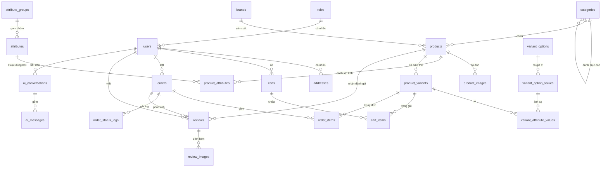

# 📊 ZenTech ERD — Mermaid Script

> **Hướng dẫn sử dụng:**
> 1. Copy toàn bộ khối code bên dưới.
> 2. Dán vào **[Mermaid Live Editor](https://mermaid.live)** → chọn tab *Code* → paste vào.
> 3. Hoặc chèn thẳng vào **Notion** bằng `/code` block → chọn ngôn ngữ `mermaid`.
> 4. Trong **Figma**: dùng plugin **Mermaid to Figma** hoặc export PNG từ Mermaid Live.

---

## Sơ đồ tổng quan (24 bảng và các quan hệ)

Chỉ gồm tên bảng và quan hệ, để nhìn được toàn bộ cấu trúc trên một trang. Sơ đồ đầy đủ từng cột nằm ngay bên dưới và trong file ảnh `06_ERD_day_du.png` (phóng to để đọc).

---

## Sơ đồ ERD đầy đủ (24 bảng)

```mermaid
erDiagram

    %% =============================================
    %% SECTION 1 — PHÂN QUYỀN & TÀI KHOẢN
    %% =============================================

    roles {
        TINYINT     id          PK  "Khóa chính"
        VARCHAR50   name            "admin | customer | staff"
        VARCHAR255  description     "Mô tả vai trò"
    }

    users {
        INT         id          PK  "Khóa chính"
        TINYINT     role_id     FK  "FK → roles.id"
        VARCHAR100  full_name       "Họ tên đầy đủ"
        VARCHAR150  email           "Email (UNIQUE)"
        VARCHAR20   phone           "Số điện thoại"
        VARCHAR255  password_hash   "Mật khẩu đã mã hóa"
        VARCHAR500  avatar_url      "Ảnh đại diện"
        ENUM        gender          "male|female|other"
        DATE        birthday        "Ngày sinh"
        TINYINT1    is_active       "1=hoạt động"
        DATETIME    created_at      "Ngày tạo"
    }

    addresses {
        INT         id          PK  "Khóa chính"
        INT         user_id     FK  "FK → users.id"
        VARCHAR100  receiver_name   "Tên người nhận"
        VARCHAR20   phone           "SĐT người nhận"
        VARCHAR100  province        "Tỉnh/Thành phố"
        VARCHAR100  district        "Quận/Huyện"
        VARCHAR100  ward            "Phường/Xã"
        VARCHAR255  street          "Địa chỉ chi tiết"
        TINYINT1    is_default      "Địa chỉ mặc định"
    }

    %% =============================================
    %% SECTION 2 — DANH MỤC & THƯƠNG HIỆU
    %% =============================================

    categories {
        INT         id          PK  "Khóa chính"
        INT         parent_id   FK  "FK → categories.id (tự tham chiếu)"
        VARCHAR150  name            "Tên danh mục"
        VARCHAR200  slug            "Đường dẫn URL (UNIQUE)"
        VARCHAR500  image_url       "Ảnh đại diện danh mục"
        TEXT        description     "Mô tả danh mục"
        SMALLINT    sort_order      "Thứ tự sắp xếp"
        TINYINT1    is_active       "1=hiển thị"
    }

    brands {
        INT         id          PK  "Khóa chính"
        VARCHAR100  name            "Tên thương hiệu"
        VARCHAR120  slug            "Đường dẫn URL (UNIQUE)"
        VARCHAR500  logo_url        "Logo thương hiệu"
        VARCHAR100  country         "Quốc gia xuất xứ"
        TEXT        description     "Mô tả thương hiệu"
        TINYINT1    is_active       "1=hiển thị"
    }

    %% =============================================
    %% SECTION 3 — SẢN PHẨM & BIẾN THỂ
    %% =============================================

    products {
        INT         id          PK  "Khóa chính"
        INT         category_id FK  "FK → categories.id"
        INT         brand_id    FK  "FK → brands.id"
        VARCHAR255  name            "Tên sản phẩm"
        VARCHAR300  slug            "Đường dẫn URL (UNIQUE)"
        VARCHAR100  sku             "Mã sản phẩm tổng"
        TEXT        short_desc      "Mô tả ngắn"
        LONGTEXT    full_desc       "Mô tả chi tiết"
        VARCHAR500  thumbnail_url   "Ảnh đại diện SP"
        DECIMAL12   base_price      "Giá tham chiếu (VNĐ)"
        TINYINT1    is_featured     "1=sản phẩm nổi bật"
        TINYINT1    is_active       "1=đang bán"
        INT         view_count      "Lượt xem"
        INT         sold_count      "Số lượng đã bán"
        DATETIME    created_at      "Ngày tạo"
        DATETIME    updated_at      "Ngày cập nhật"
    }

    product_images {
        INT         id          PK  "Khóa chính"
        INT         product_id  FK  "FK → products.id"
        VARCHAR500  image_url       "URL ảnh gallery"
        VARCHAR255  alt_text        "Mô tả alt ảnh"
        TINYINT     sort_order      "Thứ tự hiển thị"
    }

    attribute_groups {
        INT         id          PK  "Khóa chính"
        VARCHAR100  name            "Tên nhóm (VD: Thông số cảm biến)"
        TINYINT     sort_order      "Thứ tự sắp xếp"
    }

    attributes {
        INT         id          PK  "Khóa chính"
        INT         group_id    FK  "FK → attribute_groups.id"
        VARCHAR150  name            "Tên thuộc tính (VD: DPI tối đa)"
        VARCHAR30   unit            "Đơn vị (g, Hz, giờ...)"
        TINYINT     sort_order      "Thứ tự sắp xếp"
        TINYINT1    is_filterable   "1=hiển thị bộ lọc"
    }

    product_attributes {
        INT         id          PK  "Khóa chính"
        INT         product_id  FK  "FK → products.id"
        INT         attribute_id FK "FK → attributes.id"
        VARCHAR500  value           "Giá trị (VD: 25600)"
    }

    variant_options {
        INT         id          PK  "Khóa chính"
        VARCHAR80   name            "Tên tùy chọn (Màu sắc, Kết nối...)"
    }

    variant_option_values {
        INT         id          PK  "Khóa chính"
        INT         option_id   FK  "FK → variant_options.id"
        VARCHAR100  value           "Giá trị (Đen, Trắng, Wireless...)"
        VARCHAR10   color_hex       "Mã màu HEX (#1a1a1a)"
    }

    product_variants {
        INT         id          PK  "Khóa chính"
        INT         product_id  FK  "FK → products.id"
        VARCHAR120  sku             "SKU riêng (UNIQUE)"
        DECIMAL12   price           "Giá bán (VNĐ)"
        DECIMAL12   sale_price      "Giá khuyến mãi (NULL=không KM)"
        INT         stock_qty       "Số lượng tồn kho"
        VARCHAR500  image_url       "Ảnh riêng biến thể"
        TINYINT1    is_active       "1=đang bán"
        DATETIME    created_at      "Ngày tạo"
        DATETIME    updated_at      "Ngày cập nhật"
    }

    variant_attribute_values {
        INT         variant_id  FK  "FK → product_variants.id (PK)"
        INT         option_value_id FK "FK → variant_option_values.id (PK)"
    }

    %% =============================================
    %% SECTION 4 — GIỎ HÀNG & ĐƠN HÀNG
    %% =============================================

    carts {
        INT         id          PK  "Khóa chính"
        INT         user_id     FK  "FK → users.id (NULL=vãng lai)"
        VARCHAR128  session_id      "Session khách vãng lai"
        DATETIME    created_at      "Ngày tạo"
        DATETIME    updated_at      "Ngày cập nhật"
    }

    cart_items {
        INT         id          PK  "Khóa chính"
        INT         cart_id     FK  "FK → carts.id"
        INT         variant_id  FK  "FK → product_variants.id"
        SMALLINT    quantity        "Số lượng"
    }

    orders {
        INT         id              PK  "Khóa chính"
        INT         user_id         FK  "FK → users.id"
        VARCHAR30   order_code          "Mã đơn hàng (UNIQUE)"
        VARCHAR100  receiver_name       "Tên người nhận (snapshot)"
        VARCHAR20   receiver_phone      "SĐT người nhận (snapshot)"
        TEXT        shipping_address    "Địa chỉ giao (snapshot)"
        ENUM        payment_method      "cod|vnpay|momo|bank_transfer"
        ENUM        payment_status      "unpaid|paid|refunded"
        DECIMAL14   subtotal            "Tổng tiền hàng"
        DECIMAL10   shipping_fee        "Phí vận chuyển"
        DECIMAL10   discount_amount     "Số tiền giảm giá"
        DECIMAL14   total_amount        "Tổng thanh toán"
        ENUM        status              "pending|confirmed|processing|shipping|delivered|cancelled|returned"
        TEXT        note                "Ghi chú khách hàng"
        TEXT        cancelled_reason    "Lý do hủy đơn"
        DATETIME    created_at          "Ngày đặt hàng"
        DATETIME    updated_at          "Ngày cập nhật"
    }

    order_items {
        INT         id              PK  "Khóa chính"
        INT         order_id        FK  "FK → orders.id"
        INT         variant_id      FK  "FK → product_variants.id"
        VARCHAR255  product_name        "Tên SP tại thời điểm đặt"
        VARCHAR255  variant_info        "Mô tả biến thể (Đen|Wireless)"
        DECIMAL12   unit_price          "Đơn giá tại thời điểm đặt"
        SMALLINT    quantity            "Số lượng"
        DECIMAL14   total_price         "Thành tiền"
    }

    order_status_logs {
        INT         id          PK  "Khóa chính"
        INT         order_id    FK  "FK → orders.id"
        VARCHAR30   old_status      "Trạng thái cũ"
        VARCHAR30   new_status      "Trạng thái mới"
        INT         changed_by  FK  "FK → users.id (admin/staff)"
        TEXT        note            "Ghi chú thay đổi"
        DATETIME    created_at      "Thời điểm thay đổi"
    }

    %% =============================================
    %% SECTION 5 — ĐÁNH GIÁ
    %% =============================================

    reviews {
        INT         id          PK  "Khóa chính"
        INT         product_id  FK  "FK → products.id"
        INT         user_id     FK  "FK → users.id"
        INT         order_id    FK  "FK → orders.id"
        TINYINT     rating          "Số sao (1-5)"
        VARCHAR255  title           "Tiêu đề đánh giá"
        TEXT        content         "Nội dung đánh giá"
        TINYINT1    is_approved     "Admin duyệt=1"
        DATETIME    created_at      "Ngày đánh giá"
    }

    review_images {
        INT         id          PK  "Khóa chính"
        INT         review_id   FK  "FK → reviews.id"
        VARCHAR500  image_url       "URL ảnh đính kèm"
    }

    %% =============================================
    %% SECTION 6 — AI ASSISTANT
    %% =============================================

    ai_conversations {
        INT         id          PK  "Khóa chính"
        INT         user_id     FK  "FK → users.id (NULL=vãng lai)"
        VARCHAR128  session_id      "Session ID"
        VARCHAR255  title           "Tiêu đề cuộc hội thoại"
        DATETIME    created_at      "Ngày tạo"
        DATETIME    updated_at      "Ngày cập nhật"
    }

    ai_messages {
        INT         id              PK  "Khóa chính"
        INT         conversation_id FK  "FK → ai_conversations.id"
        ENUM        role                "user | assistant"
        TEXT        content             "Nội dung tin nhắn"
        SMALLINT    tokens_used         "Số token tiêu thụ"
        DATETIME    created_at          "Thời điểm gửi"
    }

    %% =============================================
    %% SECTION 7 — KHUYẾN MÃI
    %% =============================================

    coupons {
        INT         id              PK  "Khóa chính"
        VARCHAR50   code                "Mã voucher (UNIQUE)"
        VARCHAR255  description         "Mô tả khuyến mãi"
        ENUM        discount_type       "percent | fixed"
        DECIMAL10   discount_value      "Giá trị giảm"
        DECIMAL12   min_order_value     "Giá trị đơn tối thiểu"
        INT         max_uses            "Số lần sử dụng tối đa"
        INT         used_count          "Số lần đã dùng"
        DATETIME    starts_at           "Ngày bắt đầu"
        DATETIME    expires_at          "Ngày hết hạn"
        TINYINT1    is_active           "1=đang hoạt động"
    }

    %% =============================================
    %% RELATIONSHIPS
    %% =============================================

    roles                   ||--o{  users                   : "có nhiều"
    users                   ||--o{  addresses               : "có nhiều"
    users                   ||--o{  carts                   : "có"
    users                   ||--o{  orders                  : "đặt"
    users                   ||--o{  reviews                 : "viết"
    users                   ||--o{  ai_conversations        : "bắt đầu"

    categories              ||--o{  categories              : "danh mục con"
    categories              ||--o{  products                : "chứa"
    brands                  ||--o{  products                : "sản xuất"

    products                ||--o{  product_images          : "có ảnh"
    products                ||--o{  product_attributes      : "có thuộc tính"
    products                ||--o{  product_variants        : "có biến thể"
    products                ||--o{  reviews                 : "nhận đánh giá"

    attribute_groups        ||--o{  attributes              : "gom nhóm"
    attributes              ||--o{  product_attributes      : "được dùng bởi"

    variant_options         ||--o{  variant_option_values   : "có giá trị"
    variant_option_values   ||--o{  variant_attribute_values: "ánh xạ"
    product_variants        ||--o{  variant_attribute_values: "có"
    product_variants        ||--o{  cart_items              : "trong giỏ"
    product_variants        ||--o{  order_items             : "trong đơn"

    carts                   ||--o{  cart_items              : "chứa"
    orders                  ||--o{  order_items             : "gồm"
    orders                  ||--o{  order_status_logs       : "ghi log"
    orders                  ||--o{  reviews                 : "phát sinh"

    reviews                 ||--o{  review_images           : "đính kèm"
    ai_conversations        ||--o{  ai_messages             : "gồm"
```

---

> [!NOTE]
> Mermaid ERD không hỗ trợ compound PK trực quan. Bảng `variant_attribute_values` được thể hiện với 2 trường FK đóng vai trò khóa chính tổ hợp (composite PK).

> [!TIP]
> Để vẽ ERD theo chuẩn **IE Notation** đầy đủ hơn trong Figma, hãy export PNG từ Mermaid Live rồi import vào Figma → chuyển thành vector với plugin **Image Tracer**.
