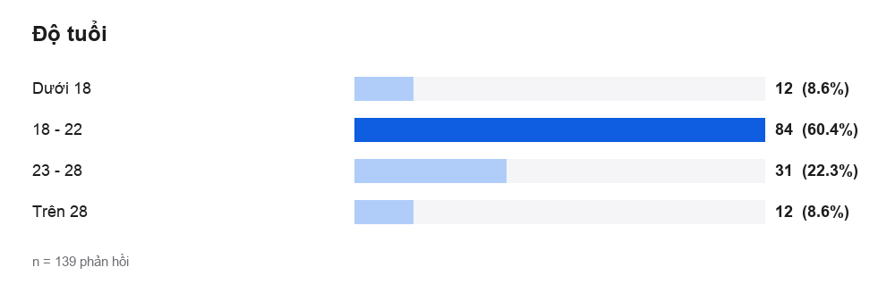
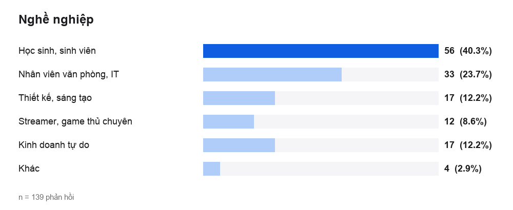
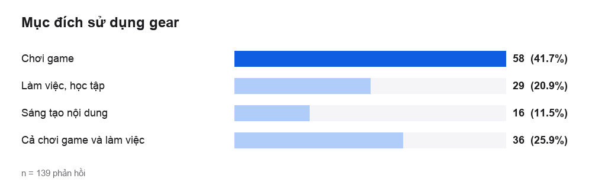
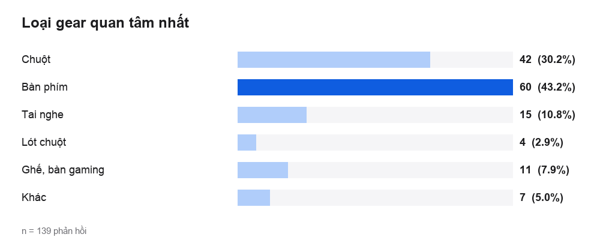
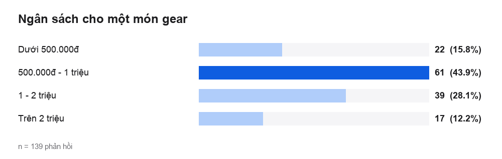
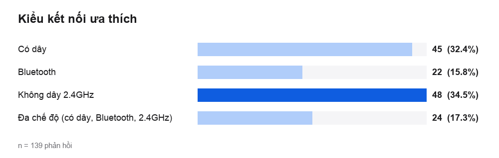
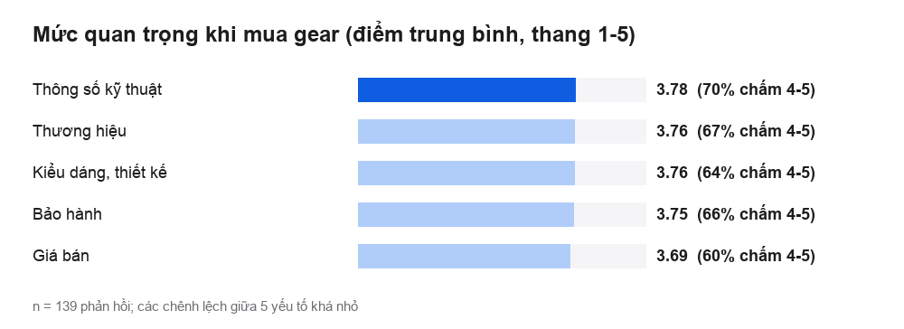
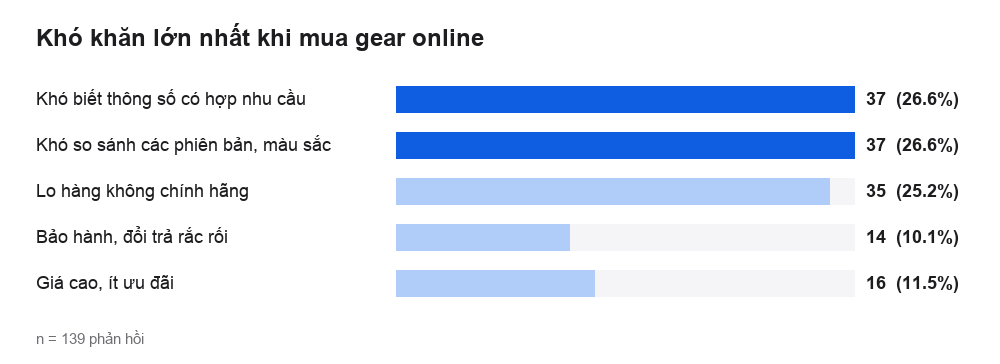
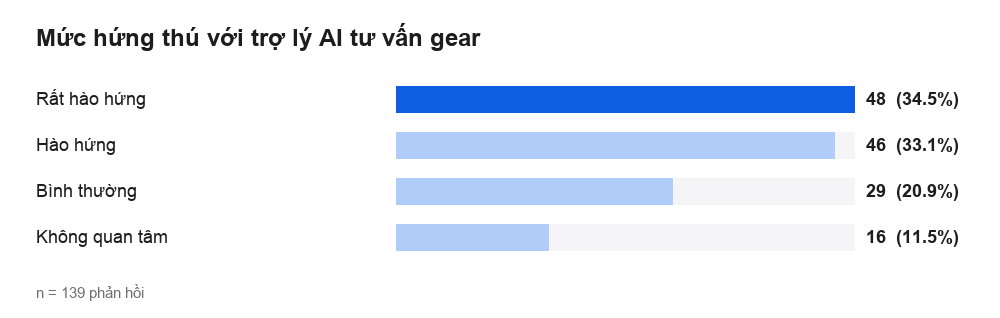

# Phân Tích Kết Quả Khảo Sát Nhu Cầu Mua Gaming Gear

> **Dự án:** ZenTech, website kinh doanh Gaming Gear  
> **Nguồn dữ liệu:** `zentech_survey_139.csv` (139 phản hồi, 15 cột)  
> **Công cụ:** Google Form, xử lý bằng `scratch/analyze_survey.py`  

---

## 1. Mục tiêu và phương pháp

Khảo sát nhằm trả lời ba câu hỏi để định hướng thiết kế: ai là người mua gaming gear, họ ưu tiên điều gì khi chọn, và họ gặp khó khăn gì khi mua online.

- **Số lượng:** 139 phản hồi, vượt mức tối thiểu 100 của đề bài. Không có hai phản hồi trùng nhau.
- **Cấu trúc:** 13 câu hỏi trắc nghiệm (độ tuổi, nghề nghiệp, mục đích, loại gear, ngân sách, kiểu kết nối, khó khăn khi mua, hứng thú với AI, 5 câu chấm mức quan trọng từ 1 đến 5) và 1 ô góp ý mở.
- **Xử lý:** file gốc lưu đáp án dưới dạng mã số. Bảng mã hóa (`zentech_survey_codebook.json`) dùng để gán nhãn, và tạo bản đã gán nhãn `zentech_survey_139_labeled.csv`. Mọi tỷ lệ dưới đây được tính lại từ 139 dòng dữ liệu bằng script, không nhập tay.

> **Lưu ý về bảng mã hóa:** các nhãn trong bảng mã hóa cần đối chiếu với nội dung câu hỏi trong Google Form gốc. Nếu có nhãn nào chưa khớp, sửa trong file `zentech_survey_codebook.json` rồi chạy lại script để cập nhật toàn bộ số liệu và biểu đồ.

---

## 2. Đối tượng được khảo sát

### Độ tuổi

| Lựa chọn | Số phản hồi | Tỷ lệ |
|---|---|---|
| Dưới 18 | 12 | 8.6% |
| 18 - 22 | 84 | 60.4% |
| 23 - 28 | 31 | 22.3% |
| Trên 28 | 12 | 8.6% |

Nhóm 18 đến 28 tuổi chiếm **82.7%** mẫu, trong đó 18 đến 22 tuổi là nhóm đông nhất (60.4%).

### Nghề nghiệp

| Lựa chọn | Số phản hồi | Tỷ lệ |
|---|---|---|
| Học sinh, sinh viên | 56 | 40.3% |
| Nhân viên văn phòng, IT | 33 | 23.7% |
| Thiết kế, sáng tạo | 17 | 12.2% |
| Streamer, game thủ chuyên | 12 | 8.6% |
| Kinh doanh tự do | 17 | 12.2% |
| Khác | 4 | 2.9% |

Học sinh, sinh viên là nhóm lớn nhất (40.3%), tiếp theo là nhân viên văn phòng và IT.

---

## 3. Hành vi và nhu cầu mua

### Mục đích sử dụng gear

| Lựa chọn | Số phản hồi | Tỷ lệ |
|---|---|---|
| Chơi game | 58 | 41.7% |
| Làm việc, học tập | 29 | 20.9% |
| Sáng tạo nội dung | 16 | 11.5% |
| Cả chơi game và làm việc | 36 | 25.9% |

Phần lớn mua để chơi game, và hơn một phần tư vừa chơi game vừa làm việc, nên gear cần dùng tốt cho cả hai mục đích.

### Loại gear quan tâm nhất

| Lựa chọn | Số phản hồi | Tỷ lệ |
|---|---|---|
| Chuột | 42 | 30.2% |
| Bàn phím | 60 | 43.2% |
| Tai nghe | 15 | 10.8% |
| Lót chuột | 4 | 2.9% |
| Ghế, bàn gaming | 11 | 7.9% |
| Khác | 7 | 5.0% |

Bàn phím và chuột chiếm **73.4%**. Tai nghe, lót chuột, ghế và bàn gaming có nhu cầu thấp hơn nhiều.

### Ngân sách cho một món gear

| Lựa chọn | Số phản hồi | Tỷ lệ |
|---|---|---|
| Dưới 500.000đ | 22 | 15.8% |
| 500.000đ - 1 triệu | 61 | 43.9% |
| 1 - 2 triệu | 39 | 28.1% |
| Trên 2 triệu | 17 | 12.2% |

**59.7%** muốn chi tối đa 1 triệu đồng cho một món gear, nhóm từ 500.000đ đến 1 triệu là đông nhất (43.9%).

### Kiểu kết nối ưa thích

| Lựa chọn | Số phản hồi | Tỷ lệ |
|---|---|---|
| Có dây | 45 | 32.4% |
| Bluetooth | 22 | 15.8% |
| Không dây 2.4GHz | 48 | 34.5% |
| Đa chế độ (có dây, Bluetooth, 2.4GHz) | 24 | 17.3% |

**67.6%** ưa chuộng các kiểu không dây (Bluetooth, 2.4GHz hoặc đa chế độ). Không dây 2.4GHz là lựa chọn đơn lẻ phổ biến nhất.

---

## 4. Yếu tố quyết định và khó khăn khi mua

### Mức quan trọng của các yếu tố (thang 1 đến 5)

| Yếu tố | Điểm trung bình | Tỷ lệ chấm 4 đến 5 |
|---|---|---|
| Thông số kỹ thuật | 3.78 | 69.8% |
| Thương hiệu | 3.76 | 66.9% |
| Kiểu dáng, thiết kế | 3.76 | 64.0% |
| Bảo hành | 3.75 | 65.5% |
| Giá bán | 3.69 | 60.4% |

Thông số kỹ thuật có điểm cao nhất (3.78), nhưng chênh lệch giữa năm yếu tố rất nhỏ (từ 3.69 đến 3.78). Nghĩa là người mua cân nhắc đồng thời nhiều yếu tố chứ không chỉ một.

### Khó khăn lớn nhất khi mua gear online

| Lựa chọn | Số phản hồi | Tỷ lệ |
|---|---|---|
| Khó biết thông số có hợp nhu cầu | 37 | 26.6% |
| Khó so sánh các phiên bản, màu sắc | 37 | 26.6% |
| Lo hàng không chính hãng | 35 | 25.2% |
| Bảo hành, đổi trả rắc rối | 14 | 10.1% |
| Giá cao, ít ưu đãi | 16 | 11.5% |

Ba khó khăn đứng đầu có tỷ lệ gần nhau (25% đến 27%): không biết thông số có hợp nhu cầu không, khó so sánh các phiên bản và màu sắc, và lo hàng không chính hãng. Hai khó khăn đầu (liên quan đến thông số và so sánh) cộng lại là **53.2%**.

### Mức hứng thú với trợ lý AI tư vấn gear

| Lựa chọn | Số phản hồi | Tỷ lệ |
|---|---|---|
| Rất hào hứng | 48 | 34.5% |
| Hào hứng | 46 | 33.1% |
| Bình thường | 29 | 20.9% |
| Không quan tâm | 16 | 11.5% |

**67.6%** hào hứng hoặc rất hào hứng với trợ lý AI tư vấn gear.

---

## 5. Góp ý mở

Có 47 trên 139 phản hồi để lại góp ý. Các góp ý lặp lại nhiều nhất:

| Góp ý | Số lần |
|---|---|
| Nên có bản demo 3D mô phỏng không gian góc setup công thái học | 7 |
| Nên bổ sung chuyên mục pass gear cũ hoặc thu cũ đổi mới chính hãng | 5 |
| Bổ sung thông tin tương thích tốt với macOS và Linux cho lập trình viên | 5 |
| Chính sách bảo hành 1 đổi 1 tận nơi sẽ là điểm cộng rất lớn cho ZenTech | 5 |
| Mong có chatbot tư vấn đúng nhu cầu kỹ thuật thay vì câu trả lời tự động chung chung | 4 |

---

## 6. Kết luận và tác động tới thiết kế

| Phát hiện từ khảo sát | Quyết định thiết kế của ZenTech |
|---|---|
| 82.7% mẫu từ 18 đến 28 tuổi, nhiều học sinh, sinh viên | Giao diện hiện đại, dùng tốt trên điện thoại, thao tác ít bước |
| 59.7% ngân sách tối đa 1 triệu đồng | Bộ lọc khoảng giá có nút chọn nhanh (dưới 500K, 500K đến 1 triệu...), lọc nhiều loại sản phẩm cùng lúc |
| Bàn phím và chuột chiếm 73.4% nhu cầu | Trang chủ và danh mục ưu tiên chuột, bàn phím; kho dữ liệu có nhiều bàn phím cơ nhất |
| 67.6% thích kết nối không dây | Danh mục riêng cho chuột không dây, tai nghe không dây, bàn phím mini/TKL |
| Thông số kỹ thuật được chấm quan trọng nhất, 53.2% khó chọn vì thông số và so sánh | Mỗi sản phẩm có tab thông số; bộ chọn màu và phiên bản cập nhật giá, ảnh và tồn kho ngay, tổ hợp không có bị gạch mờ |
| 25,2% lo hàng không chính hãng | Chính sách chính hãng, đổi trả 7 ngày, bảo hành 12 tháng hiển thị ở trang chủ và chân trang |
| 67.6% hào hứng với AI | Trợ lý ZenBot tư vấn theo ngân sách và nhu cầu |
| Góp ý: chatbot cần đúng nhu cầu kỹ thuật, so sánh trực quan | Định hướng phát triển giai đoạn sau |

## 7. Hạn chế của khảo sát

- **Mẫu thuận tiện:** 139 phản hồi, tập trung vào nhóm học sinh, sinh viên, chưa đại diện cho toàn bộ thị trường.
- **Chênh lệch nhỏ:** các câu chấm mức quan trọng có điểm gần nhau, chỉ nên dùng để thấy xu hướng, không dùng để xếp hạng chắc chắn.
- **Chưa hỏi về giao diện:** khảo sát không có câu hỏi về sở thích giao diện sáng hay tối, nên lựa chọn giao diện được quyết định theo nguyên tắc thiết kế (xem tài liệu đặc tả UI/UX), không dựa trên số liệu khảo sát.
