# ZenTech: Tài Liệu Đặc Tả Thiết Kế UI/UX

## Báo Cáo Thiết Kế Giao Diện và Trải Nghiệm Người Dùng (Dự Án 1)

> **Dự án:** Website kinh doanh Gaming Gear và phụ kiện công nghệ, ZenTech  
> **Phong cách:** Phòng trưng bày sáng, tối giản (tham chiếu Apple Store và Nothing)  
> **Bộ phông:** Be Vietnam Pro (toàn bộ giao diện)  
> **Nền tảng mục tiêu:** Web responsive (điện thoại 375px, máy tính bảng, máy tính)

---

## 1. Định hướng thiết kế

### 1.1 Người dùng và bài toán

Từ khảo sát 139 phản hồi (xem tài liệu phân tích khảo sát): 82,7% người mua ở độ tuổi 18 đến 28, 59,7% có ngân sách tối đa 1 triệu đồng, và khó khăn lớn nhất khi mua gear online là không biết thông số có hợp nhu cầu (26,6%), khó so sánh các phiên bản và màu sắc (26,6%), và lo hàng không chính hãng (25,2%).

Vì vậy giao diện phải làm được ba việc: cho thấy thông số và giá rõ ràng, cho chọn phiên bản và so sánh nhanh, và tạo cảm giác đáng tin.

### 1.2 Nguyên tắc

- **Ảnh sản phẩm là nhân vật chính.** Nền trắng và xám nhạt để ảnh nổi lên, không dùng hiệu ứng che lấp ảnh.
- **Ít chữ, chữ lớn, nhiều khoảng trống.** Tiêu đề ngắn, câu đầy đủ, không khẩu hiệu quảng cáo.
- **Một màu nhấn duy nhất cho hành động.** Xanh dương dùng cho nút chính và liên kết; đỏ chỉ cho giảm giá và lỗi; xanh lá chỉ cho trạng thái tốt.
- **Chỉ nói điều có thật.** Không có số liệu, mã giảm giá hay địa chỉ cửa hàng bịa ra.
- **Hoạt động tốt trên điện thoại trước.** Không có thanh cuộn ngang ở mọi độ rộng.

### 1.3 Quá trình chọn phong cách

Bản đầu tiên là giao diện tối với màu neon xanh và tím, thẻ kính mờ. Qua kiểm tra, bản này có ba vấn đề: ảnh sản phẩm có nền trắng hiện thành khối chói trên nền tối, hiệu ứng làm giao diện giống nhiều trang gaming khác, và khó đọc ở các trang thông tin dài. Nhóm chuyển sang phong cách phòng trưng bày sáng, và giữ nguyên toàn bộ chức năng.

---

## 2. Hệ thống Design Tokens

### 2.1 Bảng màu

| Token | Mã Hex | Vai trò |
|---|---|---|
| **Nền trang** | `#ffffff` | Nền toàn trang |
| **Bề mặt** | `#f5f5f7` | Thẻ sản phẩm, khối thông tin, vùng ảnh |
| **Đường kẻ** | `#e8e8ed` | Viền mảnh, đường phân cách |
| **Mực** | `#1d1d1f` | Chữ chính, tiêu đề |
| **Chữ phụ** | `#6e6e73` | Mô tả, nhãn, thông tin phụ |
| **Xanh hành động** | `#0f5de0` | Nút chính, liên kết, trạng thái chọn (hover `#0b4fc2`) |
| **Đỏ giảm giá** | `#d92d20` | Nhãn giảm giá, lỗi nhập liệu |
| **Xanh lá** | `#097a3c` | Còn hàng, thành công |
| **Vàng sao** | `#e8a100` | Sao đánh giá |

Tỷ lệ tương phản: chữ mực trên nền trắng 16,8:1, chữ phụ 5,1:1 trên nền trắng và 4,7:1 trên nền bề mặt, nút chính (chữ trắng trên `#0f5de0`) 5,7:1, chữ đỏ và chữ xanh lá trên nền trắng cũng trên 4,5:1. Tất cả đạt chuẩn WCAG AA.

### 2.2 Typography

| Cấp bậc | Phông chữ | Cỡ chữ và trọng số | Áp dụng |
|---|---|---|---|
| Tiêu đề trang chủ | Be Vietnam Pro | 40 đến 60px, Bold 700 | "Chọn gear theo thông số." |
| Tiêu đề mục | Be Vietnam Pro | 28 đến 36px, Bold 700 | Tên các mục trên trang |
| Tên sản phẩm | Be Vietnam Pro | 15px, SemiBold 600 | Thẻ sản phẩm |
| Nội dung | Be Vietnam Pro | 14 đến 18px, Regular 400 | Mô tả, đoạn văn |
| Nhãn nhỏ | Be Vietnam Pro | 12px, Medium 500 | Tên hãng, ghi chú |
| Số liệu | Be Vietnam Pro | Chữ số đều nhau (`tabular-nums`) | Giá, số lượng, tổng tiền |

Tiêu đề dùng khoảng cách chữ hẹp hơn (-0,025em) và tự cân bằng dòng. Phông Be Vietnam Pro được chọn vì được thiết kế cho tiếng Việt, hiển thị đủ dấu.

### 2.3 Hình khối và chuyển động

- **Bo góc:** nút dạng viên thuốc (pill), thẻ và khung 16 đến 24px.
- **Đổ bóng:** gần như không dùng; chỉ có bóng nhẹ ở thông báo nổi và hộp thoại.
- **Chuyển động:** một hiệu ứng vào trang nhẹ (trượt lên 14px, 0,6 giây), hiệu ứng phóng ảnh sản phẩm 4% khi di chuột, và thông báo nổi. Tự tắt khi người dùng bật chế độ giảm chuyển động.
- **Phản hồi bàn phím:** khung viền xanh rõ ràng khi focus; hộp thoại đóng bằng Esc.

---

## 3. Thành phần giao diện

### 3.1 Thẻ sản phẩm
Vùng ảnh vuông nền `#f5f5f7`, ảnh trộn màu để nền trắng hòa vào. Bên dưới là tên hãng (chữ phụ), tên sản phẩm (tối đa 2 dòng), giá bắt đầu bằng "Từ" kèm giá gốc gạch ngang nếu đang giảm. Nhãn "Giảm N%" màu đỏ nằm góc ảnh. Cả thẻ là một liên kết duy nhất.

### 3.2 Bộ lọc dạng cửa sổ (pop-up)
- Nút "Bộ lọc" đặt phía trên lưới sản phẩm, có số đếm bộ lọc đang bật.
- Cửa sổ chứa ba nhóm: **Loại sản phẩm** và **Thương hiệu** (chọn nhiều cùng lúc, dạng nút bấm), **Khoảng giá** (5 nút chọn nhanh và hai ô nhập tay).
- Bộ lọc đang áp dụng hiện thành các thẻ nhỏ phía trên lưới, bấm dấu × để bỏ từng thẻ, hoặc "Xóa tất cả".
- Khi không có kết quả: giải thích rõ và nút "Đặt lại bộ lọc".
- Sắp xếp (mới nhất, giá tăng, giá giảm, tên) nằm cùng hàng với nút Bộ lọc. Phân trang gọn: Trước, 1, ..., trang hiện tại, ..., cuối, Sau.

### 3.3 Bộ chọn biến thể (trang chi tiết)
- Màu sắc và phiên bản là hai nhóm nút. Nút đang chọn có viền và nền xanh nhạt.
- Khi chọn, giá, giá gốc, ảnh, tồn kho và mã biến thể đổi ngay, không tải lại trang.
- Tổ hợp không tồn tại bị mờ và gạch ngang; bấm vào sẽ tự chuyển sang biến thể có thật, để hàng hiển thị luôn khớp hàng được thêm vào giỏ.
- Hết hàng: hiện "Hết hàng" và khóa cả hai nút mua.

### 3.4 Tìm kiếm nhanh (Ctrl + K)
Hộp tìm kiếm mở ở giữa màn hình. Khi chưa gõ hiện các gợi ý tìm kiếm. Khi gõ (chờ 300ms) hiện vòng quay chờ, rồi danh sách kết quả có tô sáng từ khóa. Phím mũi tên chọn kết quả, Enter mở; không chọn gì thì Enter mở toàn bộ kết quả. Có liên kết "Xem tất cả kết quả".

### 3.5 Thông báo
Mọi hành động (đăng ký, đặt hàng, hủy đơn, đăng xuất, thêm vào giỏ) có thông báo nổi ở góc màn hình. Lỗi nhập liệu hiện danh sách lỗi cụ thể, và giữ lại dữ liệu người dùng đã nhập.

### 3.6 Trợ lý ZenBot
Nút tròn cố định góc dưới bên phải, mở cửa sổ chat. Có ba câu hỏi gợi ý sẵn. Khi chưa cấu hình khóa API, ZenBot trả lời bằng bộ câu mẫu theo chủ đề (chuột, bàn phím, tai nghe, giá).

---

## 4. Luồng người dùng

### 4.1 Khám phá đến đặt hàng

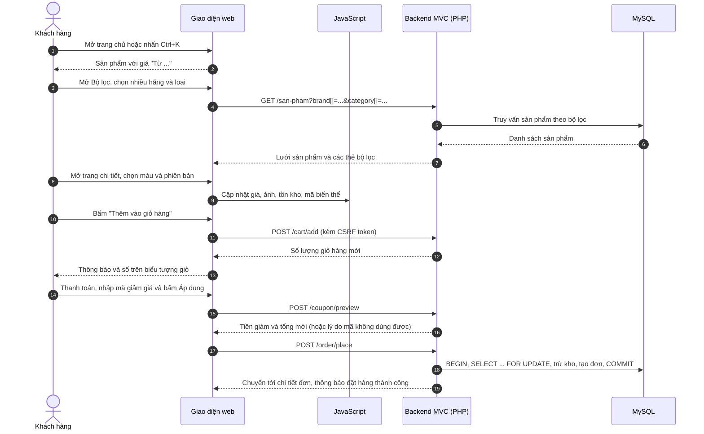

### 4.2 Trợ lý ZenBot

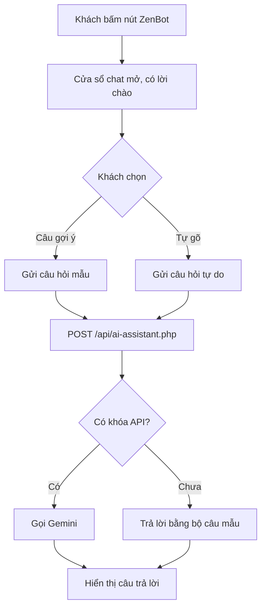

---

## 5. Danh mục màn hình

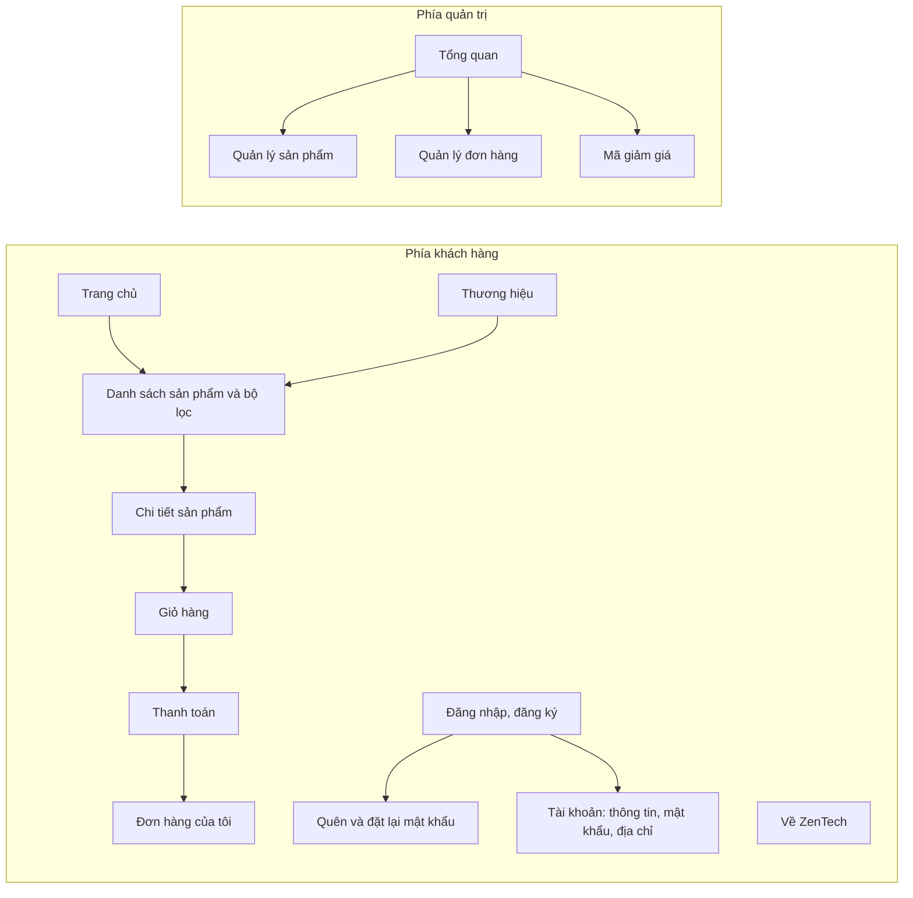

| Màn hình | Nội dung chính |
|---|---|
| Trang chủ | Tiêu đề, sản phẩm nổi bật có giá và nút mua, chính sách giao hàng, đổi trả, bảo hành, mua theo loại, sản phẩm nổi bật, ZenBot, hàng mới về |
| Danh sách sản phẩm | Nút Bộ lọc, thẻ bộ lọc đang bật, sắp xếp, lưới 4 cột, phân trang |
| Thương hiệu | Danh sách hãng kèm số sản phẩm và giá thấp nhất, bấm vào mở danh sách đã lọc |
| Chi tiết sản phẩm | Bộ ảnh, tên, đánh giá, giá, bộ chọn màu và phiên bản, số lượng, nút Thêm vào giỏ và Mua ngay, tab thông số, mô tả, đánh giá, sản phẩm liên quan |
| Giỏ hàng, thanh toán | Danh sách hàng, sửa số lượng, tóm tắt đơn, form giao hàng, 3 cách thanh toán |
| Đăng nhập, đăng ký | Form một cột, báo lỗi cụ thể, giữ lại dữ liệu đã nhập, liên kết "Quên mật khẩu?" |
| Quên và đặt lại mật khẩu | Nhập email, nhận liên kết hiệu lực 30 phút, đặt mật khẩu mới từ 8 ký tự; thông báo chung để không lộ email có tồn tại |
| Tài khoản | Sửa họ tên và số điện thoại, đổi mật khẩu, sổ địa chỉ (thêm, xóa, đặt mặc định); địa chỉ đã lưu chọn nhanh được ở trang thanh toán |
| Thanh toán (mã giảm giá) | Ô nhập mã và nút "Áp dụng": xem tiền giảm và tổng mới trước khi đặt hàng; mã sai báo lỗi cụ thể |
| Chi tiết sản phẩm (đánh giá) | Khách đã nhận hàng mới có form đánh giá (số sao, nhận xét), mỗi sản phẩm một lần; thanh phân bố sao tính từ đánh giá thật |
| Quản trị: mã giảm giá | Bảng mã kèm lượt đã dùng, form tạo mã, bật/tắt mã |
| Quản trị | Tổng quan, bảng sản phẩm và đơn hàng, menu bên trái (thu thành ngăn kéo trên điện thoại) |

---

## 6. Khả năng tiếp cận và đáp ứng thiết bị

- Chữ và nút đạt tương phản AA; mọi phần tử tương tác có khung focus rõ.
- Cửa sổ bộ lọc dùng thẻ `dialog` gốc của trình duyệt (Esc để đóng, giữ focus trong cửa sổ, trả focus khi đóng).
- Nút bấm có nhãn đọc được cho trình đọc màn hình (nhãn nút yêu thích, đóng, bỏ lọc).
- Bố cục kiểm tra ở 375px và 800px, không tràn ngang. Lưới sản phẩm đổi từ 4 cột xuống 2 cột.
- Chế độ giảm chuyển động của hệ điều hành được tôn trọng.

---

## 7. Hình ảnh giao diện thực tế

Ảnh chụp từ website đang chạy (dữ liệu từ database). Toàn bộ 24 ảnh gốc nằm trong thư mục `hinh_anh_giao_dien`.

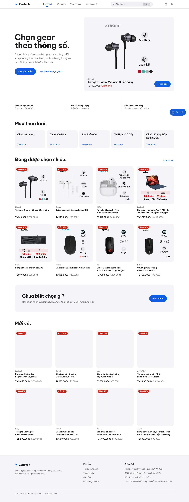

*Hình 1. Trang chủ: tiêu đề, sản phẩm nổi bật có giá và nút mua, chính sách thật, mua theo loại, sản phẩm nổi bật, ZenBot, hàng mới về.*

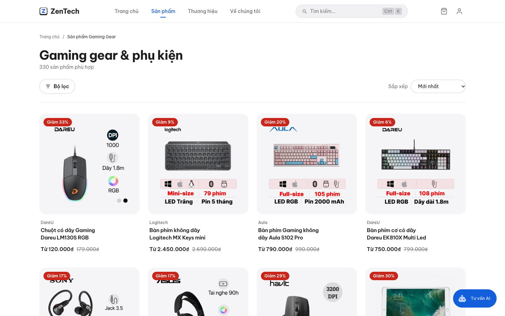

*Hình 2. Danh sách sản phẩm: nút Bộ lọc, sắp xếp, lưới thẻ sản phẩm, 330 sản phẩm.*

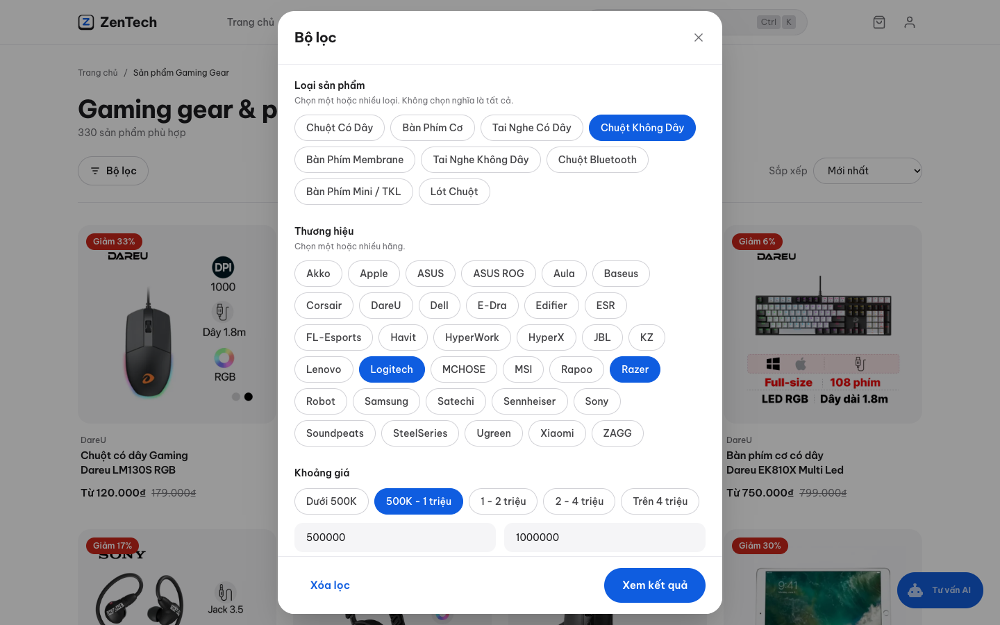

*Hình 3. Bộ lọc dạng cửa sổ: chọn nhiều loại sản phẩm, nhiều thương hiệu và khoảng giá.*

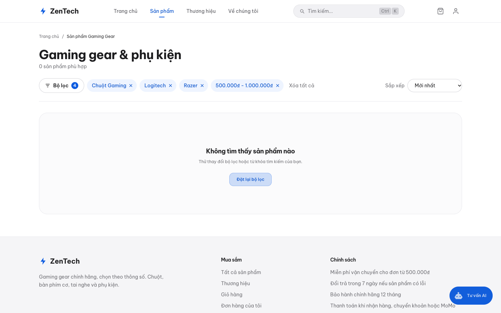

*Hình 4. Kết quả sau khi lọc: các thẻ bộ lọc đang áp dụng, bấm × để bỏ từng thẻ.*

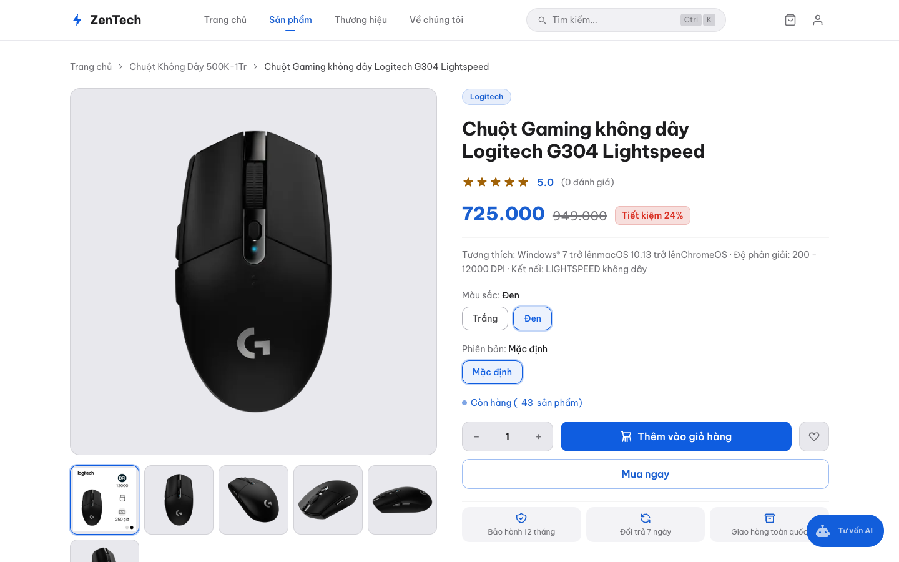

*Hình 5. Chi tiết sản phẩm: bộ ảnh, giá và giá gốc, bộ chọn màu và phiên bản, tồn kho.*

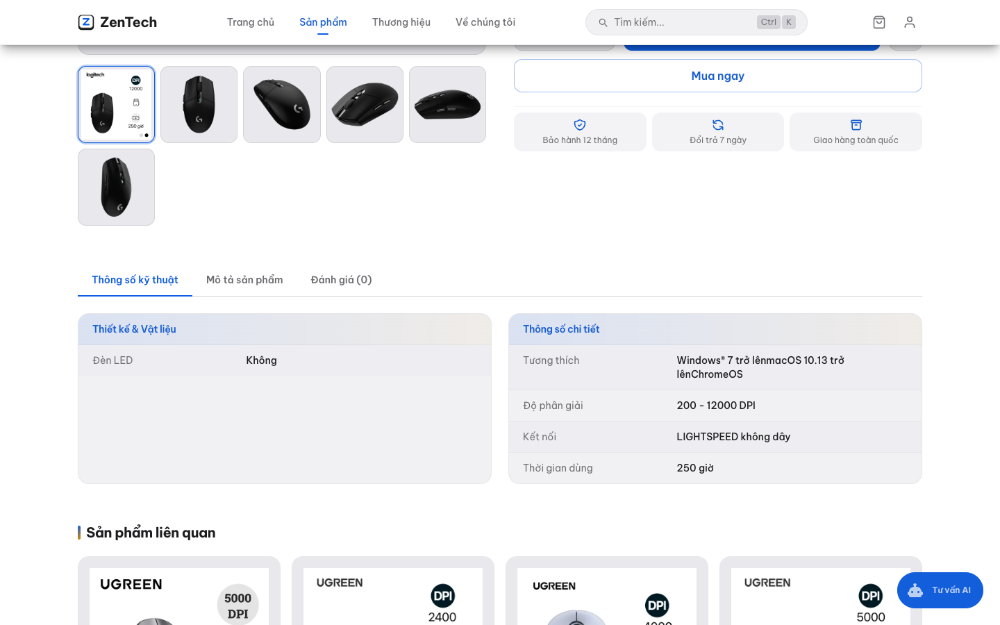

*Hình 6. Chi tiết sản phẩm: tab thông số kỹ thuật theo nhóm.*

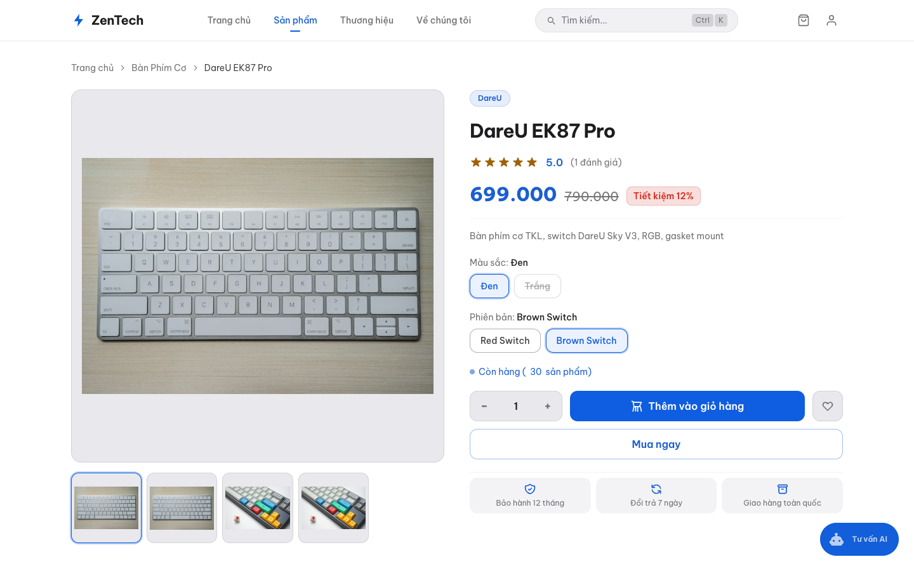

*Hình 7. Chọn tổ hợp không tồn tại (Trắng với Brown Switch): tự chuyển sang biến thể có thật, tổ hợp không có bị mờ gạch ngang.*

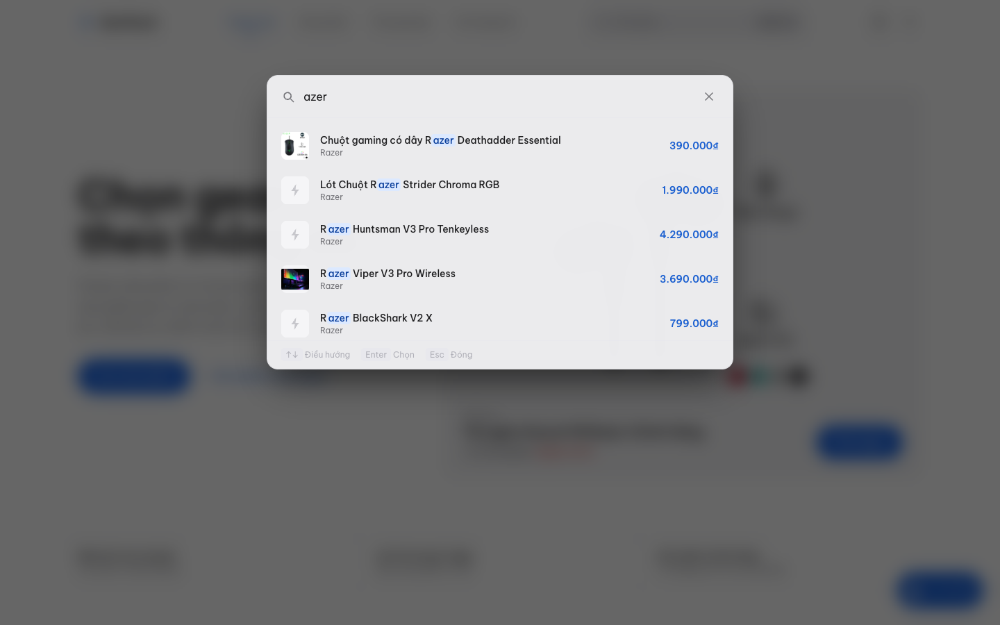

*Hình 8. Tìm kiếm nhanh (Ctrl + K) có tô sáng từ khóa và liên kết xem tất cả kết quả.*

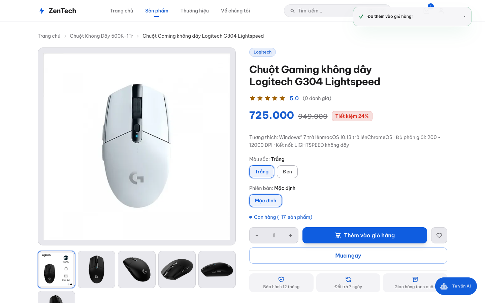

*Hình 9. Thêm vào giỏ hàng: thông báo nổi và số lượng trên biểu tượng giỏ.*

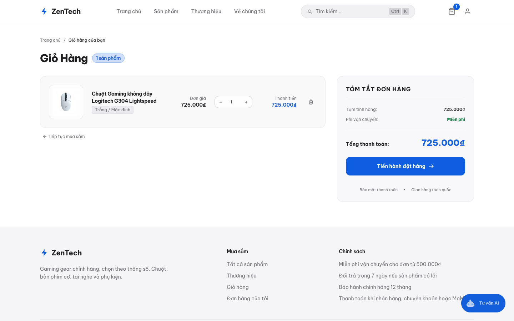

*Hình 10. Giỏ hàng: sửa số lượng, tóm tắt đơn, phí vận chuyển.*

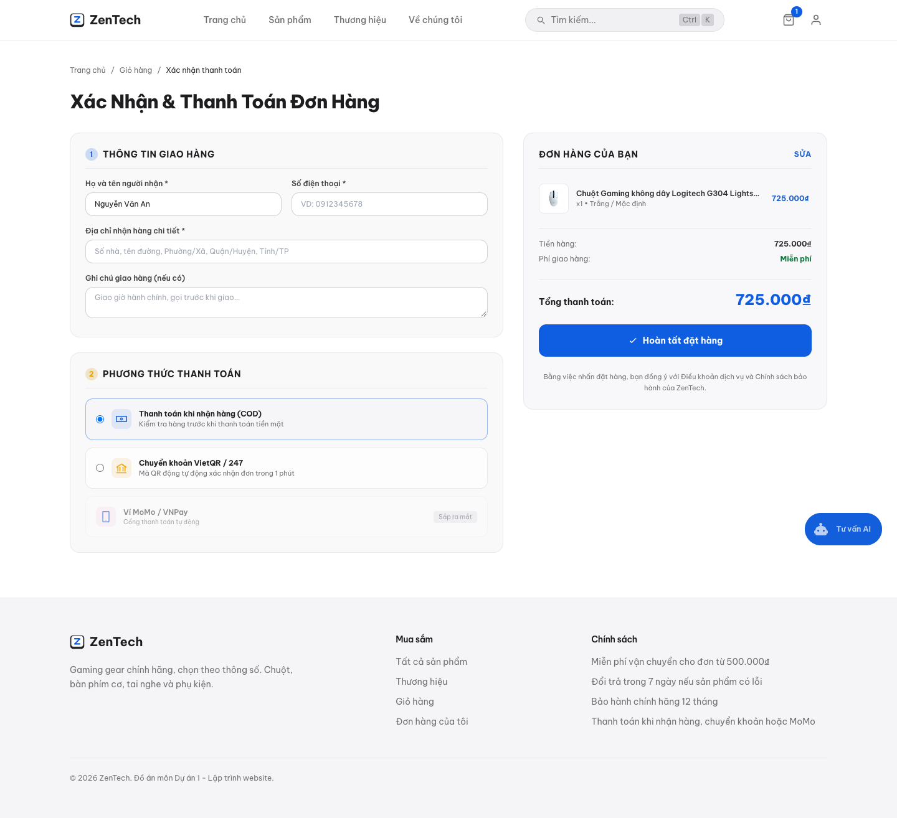

*Hình 11. Thanh toán một trang: thông tin giao hàng, phương thức thanh toán, tóm tắt đơn.*

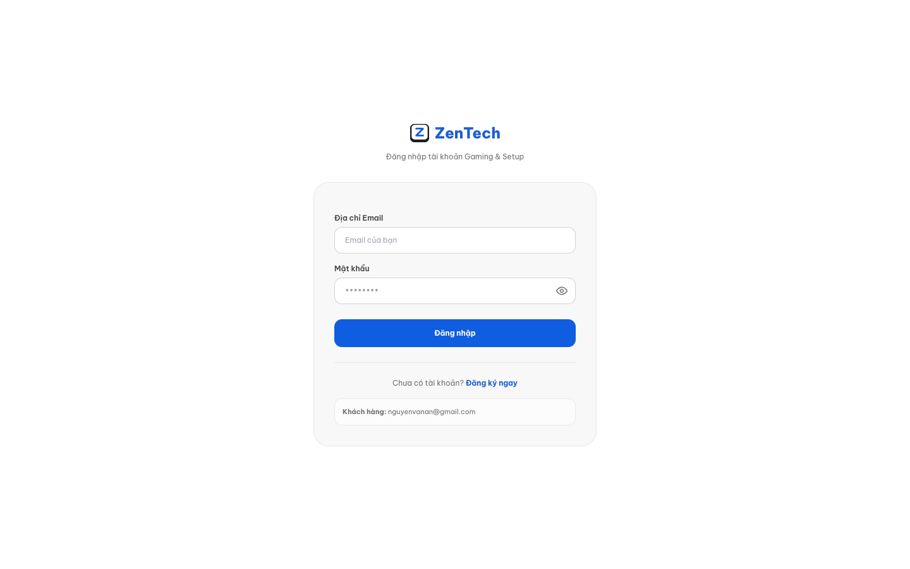

*Hình 12. Đăng nhập.*

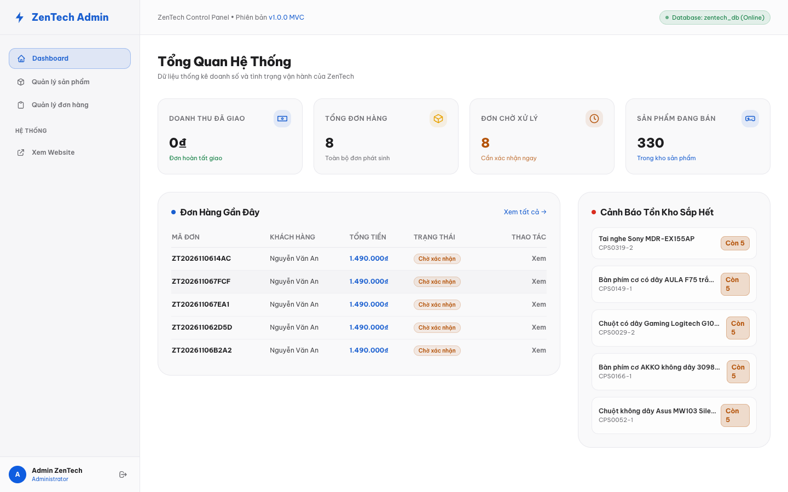

*Hình 13. Quản trị: tổng quan doanh thu, đơn hàng, cảnh báo tồn kho.*

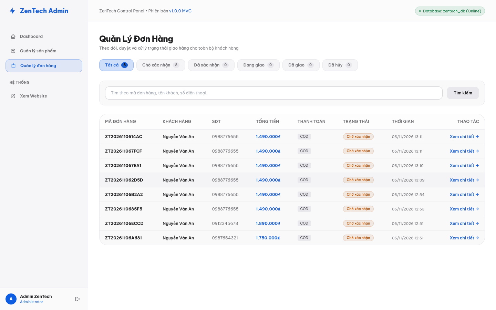

*Hình 14. Quản trị: danh sách đơn hàng theo trạng thái.*

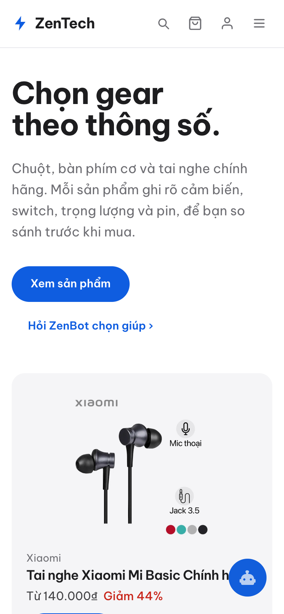

*Hình 15. Điện thoại: trang chủ.*

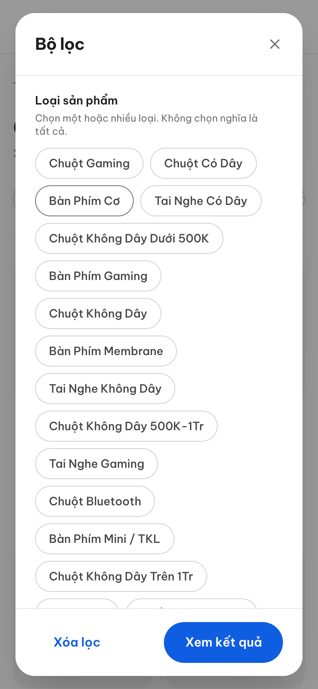

*Hình 16. Điện thoại: cửa sổ bộ lọc.*

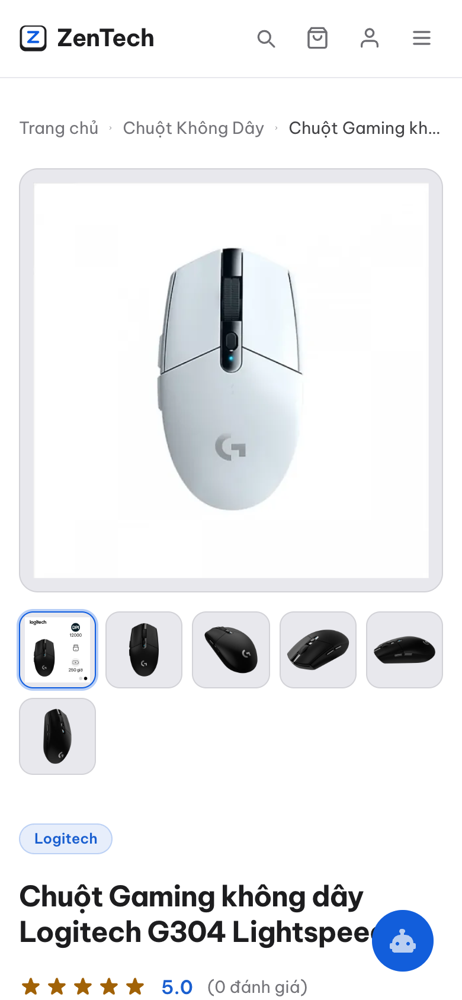

*Hình 17. Điện thoại: chi tiết sản phẩm.*

---

> Bản mẫu tương tác của hệ thống thiết kế: [`zentech_uiux_design_system.html`](zentech_uiux_design_system.html)
